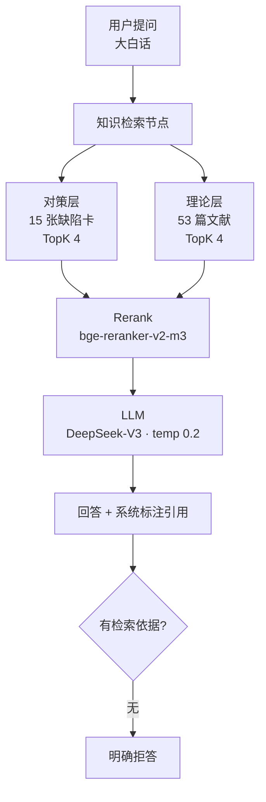

# 匠枢 · 注塑工艺知识库智能体

> 把注塑厂的工艺文档变成**可溯源、不编造**的问答助手。

[](https://dify.ai)
[](https://qdrant.tech)
[](LICENSE)

---

## 为什么做这个

注塑厂最贵的资产不是注塑机，是调机师傅。

一个熟练调机工从学徒到能独立处理缺陷要三到五年，人一走经验就带走了。新人遇到缩水、飞边、熔接痕，只能靠试错——一版模具试错成本几千到几万，周期按天算。

通用大模型帮不上忙：它不知道你们厂用什么料、什么机台，而且**会给一个看起来完全合理的错误参数**。工业场景里，一个敢编模温的助手，没人敢用。

所以这个项目只解决一件事：**让工艺知识能被查，且每一条都能追到出处**。

---

## 它是什么

一个基于 Dify 构建的 Chatflow 应用，核心是**双层知识库 + 强制不编造**。



**为什么分两层**：卡片是精准答案（现象→原因→排查→对策），论文是背景知识。混在一个库里检索，长文本会把卡片挤掉——早期版本就是因为这个，问缩水答成了翘曲。

---

## 效果

| 提问 | 回答要点 | 来源 |
|---|---|---|
| PP 料打出来表面缩水怎么办 | 保压、模温、浇口四个方向，附"数值需试模确定" | 缺陷卡 C01 |
| 注塑件翘曲变形的原因 | 冷却不均、收缩差异、玻纤取向等 6 条 | 卡片 + 英文论文 + 中文资料 |
| 你们给美的做过什么项目 | 一句话拒答，不转移话题 | — |
| 这个件保压应该设多少 MPa | 说明需试模，**不给具体数值** | — |

> 第三、四题是**故意设计**的。工业场景里，宁可说不知道，也不能说错。

截图见 [`docs/screenshots/`](docs/screenshots)。

---

## 技术要点

### 1. 文档清洗（这步最脏也最重要）

79 篇下载来的 PDF，直接入库基本没法用：页眉页脚、参考文献、DOI、双栏导致的重复段落，还有**字体加密导致的整篇乱码**（提取出来是 `7KHPDQXDO`）。

`tools/clean_pdf.py` 做了五件事：

- 统计出现在半数页面以上的短行 → 判定为页眉页脚并删除
- 从 `References` / `参考文献` / `致谢` 处截断
- 从 `Abstract` / `摘要` 处起始，砍掉出版社模板文字
- 依据"行宽显著短于中位数"判定段落边界，合并 PDF 硬换行
- 去重完全相同段落

清洗后 79 篇里 **53 篇可用**，26 篇是字体加密或扫描件——`tools/check_quality.py` 会自动分类出来（这些必须 OCR，不是脚本能救的）。

### 2. 分层检索

两个知识库分别检索、独立配置 TopK 与 Rerank，再合并注入上下文。卡片不会被论文的长文本挤掉。

### 3. 防幻觉

踩过的坑：早期版本给 PP 缩水编出过"某公司某牌号、保压 50–80%"，**连来源文件名都是编的**。评委只要问一句"这份资料能给我们看看吗"就穿帮。

现在做了三件事：

- 提示词里**逐项列举禁止编造的对象**：牌号、公司名、百分比、秒数、温度值、公式、文件名，包括"建议/大约/比如"开头的估算
- **不让模型写来源**，引用由系统自动标注——模型没机会编文件名
- 提示词从 11 条精简到 6 条，规则太多模型会钻空子

### 4. 可评测

24 道题的评测集，分三类：单缺陷题、复合题、**拒答题**。

拒答卷 4 道全部通过——这是比准确率更重要的指标。

---

## 快速开始

### 1. 部署 Dify

```bash
git clone https://github.com/langgenius/dify.git
cd dify/docker
cp .env.example .env
docker compose up -d
```

> 国内建议先配 `registry-mirrors`，否则拉镜像会卡死。详见 [deploy/README.md](deploy/README.md)。

### 2. 导入应用

Dify 控制台 → 工作室 → 创建 → **导入应用包** → 选 `app/jiangshu.ifpkg`

> 也支持导入 `app/jiangshu.dsl.yml`（纯 DSL，兼容旧版本）。
> ⚠️ 应用包不含模型配置和知识库，需要自己配。

### 3. 配模型

集成 → 模型供应商 → 安装 **SiliconFlow**，填 API Key（`cloud.siliconflow.cn`）。

默认模型设为：

| 用途 | 模型 |
|---|---|
| 系统推理 | `deepseek-ai/DeepSeek-V3` |
| Embedding | `BAAI/bge-m3` |
| Rerank | `BAAI/bge-reranker-v2-m3` |

### 4. 建知识库

**对策层**（工艺知识卡）

- 创建知识库 → 通用分段
- 分隔符自定义 `---`，最大 1024 字符，**重叠 0**
- ⚠️ **取消勾选"替换连续换行"**，否则分隔符失效
- 上传 `knowledge/cards/injection-defect-cards.md`

**理论层**（文献）

- 父子分段：父 `\n\n` / 1024，子 `\n` / 256，同样取消换行替换
- 上传自己清洗后的文献 txt（见下节说明）

### 5. 验证

进应用预览，问：`PP 料打出来表面缩水怎么办`

应该给出 C01 卡片里的四条对策，末尾有系统标注的引用。

---

## 仓库结构

```
jiangshu/
├── app/
│   ├── jiangshu.ifpkg            # Dify 应用包，直接导入
│   ├── jiangshu.dsl.yml          # 纯 DSL，兼容旧版导入
│   └── README.md                 # 导入说明
├── knowledge/
│   ├── cards/
│   │   └── injection-defect-cards.md   # 15 张缺陷卡
│   └── README.md                 # 建库参数与文献处理流程
├── tools/
│   ├── clean_pdf.py              # PDF 清洗
│   ├── check_quality.py          # 清洗质量分类
│   └── organize.py               # 统一重命名与归档
├── eval/
│   └── recall-testset.md         # 24 题评测集
├── docs/
│   ├── demo-script.md            # 演示脚本与问答预案
│   └── screenshots/              # 运行截图
└── deploy/
    └── README.md                 # 部署踩坑记录
```

---

## 关于文献数据

**本仓库不分发论文全文。** 那 53 篇文献来自公开期刊与国家标准，版权归原作者，清洗后的文本仍是衍生作品，不适合公开分发。

`knowledge/README.md` 里列了文献清单（标题、来源、年份），可以自行获取后用 `tools/clean_pdf.py` 处理成同样的格式。

知识卡（`knowledge/cards/`）是作者依据公开教材与材料商加工指南整理的，以 MIT 协议开源。

---

## 已知限制

这个项目是**可行性验证**，不是产品。诚实列一下边界：

- 只覆盖 15 类注塑缺陷，超出范围一律拒答
- **中文提问检索英文文献，召回分数明显偏低**（0.04–0.13），因为语料与用户语言不匹配——这是下一步要解决的
- 26 篇字体加密/扫描件文献尚未 OCR
- 评测集只跑了一部分，完整准确率数据还没有
- 工人在车间不会打开网页。真正可用的入口应该是质检工位扫码、企业微信机器人，这超出了当前验证范围

---

## License

代码与知识卡：[MIT](LICENSE)

---

## 致谢

- [Dify](https://github.com/langgenius/dify) — 应用编排底座
- [Qdrant](https://qdrant.tech) — 向量检索
- [SiliconFlow](https://siliconflow.cn) — 模型服务
- [PyMuPDF](https://pymupdf.readthedocs.io) — PDF 解析
